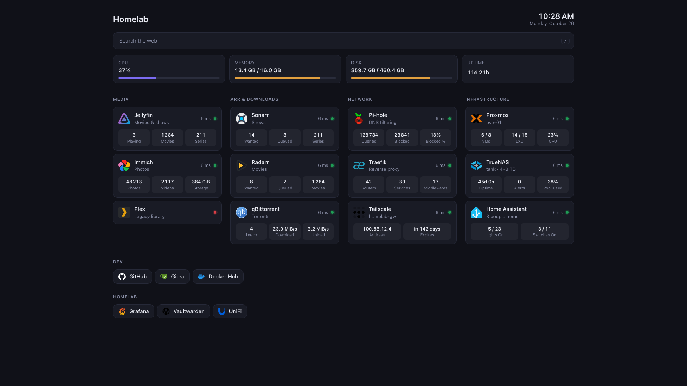

# homepage

A homelab dashboard written in Rust (actix-web), inspired by [gethomepage.dev](https://gethomepage.dev):
service cards with status checks and live stats, bookmarks, Docker and Kubernetes discovery,
a command palette, all from one hot-reloaded YAML file.



<sub>Demo data: the config is in [`docs/demo/`](docs/demo/config.yaml).</sub>

- **Status checks**: HTTP(S), TCP and Docker container state, with latency.
- **140 service widgets** (\*arr, torrent clients, Pi-hole, Proxmox, Jellyfin…), declared in
  YAML with jq; add your own without recompiling. API keys never reach the browser.
- **Discovery** from Docker labels and Kubernetes Ingress annotations, compatible with
  gethomepage.dev.
- **Hot reload**: an invalid edit shows the error in the page and keeps serving the last valid
  config.
- **Secrets** from environment variables (`${VAR}`) or files (`${file:/run/secrets/x}`).
- **Command palette** (`Ctrl+K` / `⌘K`) with fuzzy search and web search.
- Single static binary, distroless non-root image for `amd64` and `arm64`.

## Quick start

```bash
docker run -d -p 3000:3000 -v ./config:/config:ro ghcr.io/mysecurehomelab/homepage:latest
```

with `./config/config.yaml` (start from [`config.example.yaml`](config.example.yaml)), then open
http://localhost:3000.

From source:

```bash
cp config.example.yaml config.yaml
cargo run --release
```

```yaml
title: Homelab
groups:
  - name: Media
    services:
      - name: Sonarr
        url: https://sonarr.lan
        icon: sonarr
        check: https://sonarr.lan
        widget:
          type: sonarr
          key: ${SONARR_API_KEY}
bookmarks:
  - name: Dev
    links:
      - { name: GitHub, url: https://github.com, icon: github }
```

## Documentation

| | |
|---|---|
| [Configuration](docs/configuration.md) | Every config key, checks, icons, header widgets, secrets, hot reload, discovery labels, shortcuts, CLI, endpoints, security. |
| [Deployment](docs/deployment.md) | Docker, Docker Compose, Kubernetes, systemd, reverse proxy and auth, migrating from gethomepage, upgrades, troubleshooting, CI/CD and releases. |
| [Widget types](docs/widget-types.md) | The 140 built-in widgets with their options and fields. |
| [Writing widgets](docs/widgets.md) | The declarative widget format: requests, auth and login, jq fields, formats. |
| [Changelog](CHANGELOG.md) | What changed in each version. |
| [Roadmap](FEATURES.md) | Planned features. |

## Development

```bash
cargo test                              # also validates config.example.yaml and every widget
cargo clippy --all-targets -- -D warnings
UPDATE_DOCS=1 cargo test widget_types_doc   # after changing widgets/*.yaml
```
